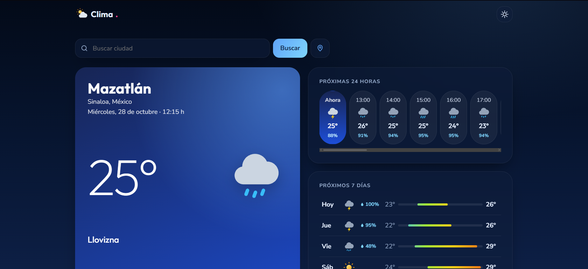

# Clima Mazatlán

App web que muestra el clima actual, las próximas 24 horas y los próximos 7 días de Mazatlán o de cualquier ciudad del mundo. Hecha con HTML, CSS y JavaScript, sin frameworks.

**Demo:** https://clima-eduardocruz.netlify.app



## Funciones

- **Clima actual:** temperatura, condición, máxima y mínima del día, sensación térmica, humedad y viento.
- **Próximas 24 horas:** empieza en la hora actual de la ciudad e indica la probabilidad de lluvia cuando es de 20 % o más.
- **Próximos 7 días:** con una barra de mínima a máxima de la semana y la probabilidad de lluvia.
- **Búsqueda de ciudades:** si hay varias con el mismo nombre, te deja elegir.
- **Mi ubicación:** usa la geolocalización del navegador.
- **Cielo dinámico:** los colores cambian según el clima (despejado, nublado, lluvia, tormenta, nieve o noche).
- **Íconos SVG propios** en lugar de emojis, para que se vean igual en cualquier dispositivo.
- **Modo claro y oscuro,** que se guarda en el navegador.
- **Recuerda la última ciudad** que consultaste.
- **Manejo de errores:** avisa si no hay internet, si la ciudad no existe o si el servidor tarda demasiado, con un botón para reintentar.
- **Estados de carga** con animación.
- **Responsive (mobile first)** y accesible: navegación con teclado, textos para lectores de pantalla y respeto a `prefers-reduced-motion`.

## Tecnologías

- HTML5, CSS3 (variables, Grid, `@property`) y JavaScript (ES6+).
- `fetch` con `async/await` y `AbortController` para cancelar peticiones lentas.
- [Open-Meteo API](https://open-meteo.com/): pronóstico y geocodificación, gratuita y sin clave.
- `localStorage` para guardar la ciudad y el tema.

## Cómo usarlo

1. Clona el repositorio:

   ```bash
   git clone https://github.com/eduardocruzoleta-prog/clima-mazatlan.git
   ```

2. Abre `index.html` con Live Server en VS Code, o directamente en el navegador.

No necesita instalar nada ni configurar ninguna clave.

## Estructura

```
clima-mazatlan/
├── index.html   # estructura de la página y los íconos SVG
├── style.css    # diseño, temas de color y responsive
└── script.js    # conexión con la API y dibujo del clima
```

## Lo que aprendí

- Consumir una API REST con `fetch` y manejar sus errores: sin conexión, tiempo agotado y respuestas con error.
- Crear elementos con `textContent` en lugar de `innerHTML` para evitar inyección de código (XSS).
- Trabajar con la hora local de cada ciudad usando `timezone=auto`.
- Organizar el diseño con variables CSS para cambiar de tema sin reescribir estilos.

## Créditos

Datos del clima de [Open-Meteo.com](https://open-meteo.com/), bajo licencia [CC BY 4.0](https://creativecommons.org/licenses/by/4.0/).

## Autor

**Eduardo Cruz Oleta**: estudiante de Ingeniería en Tecnologías de la Información e Innovación Digital, Universidad Politécnica de Sinaloa.

- Portafolio: https://portafolio-eduardocruz.netlify.app
- GitHub: [@eduardocruzoleta-prog](https://github.com/eduardocruzoleta-prog)